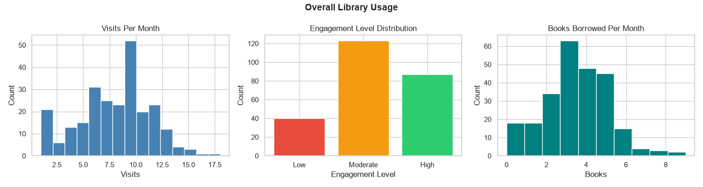
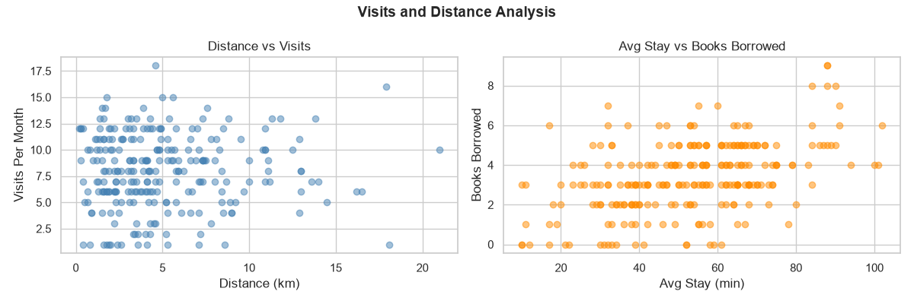
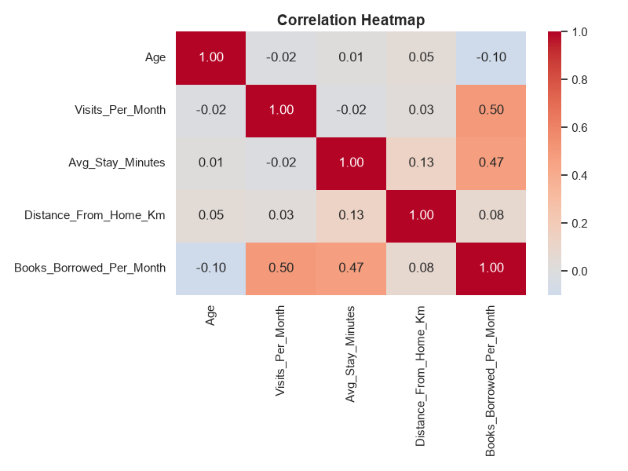
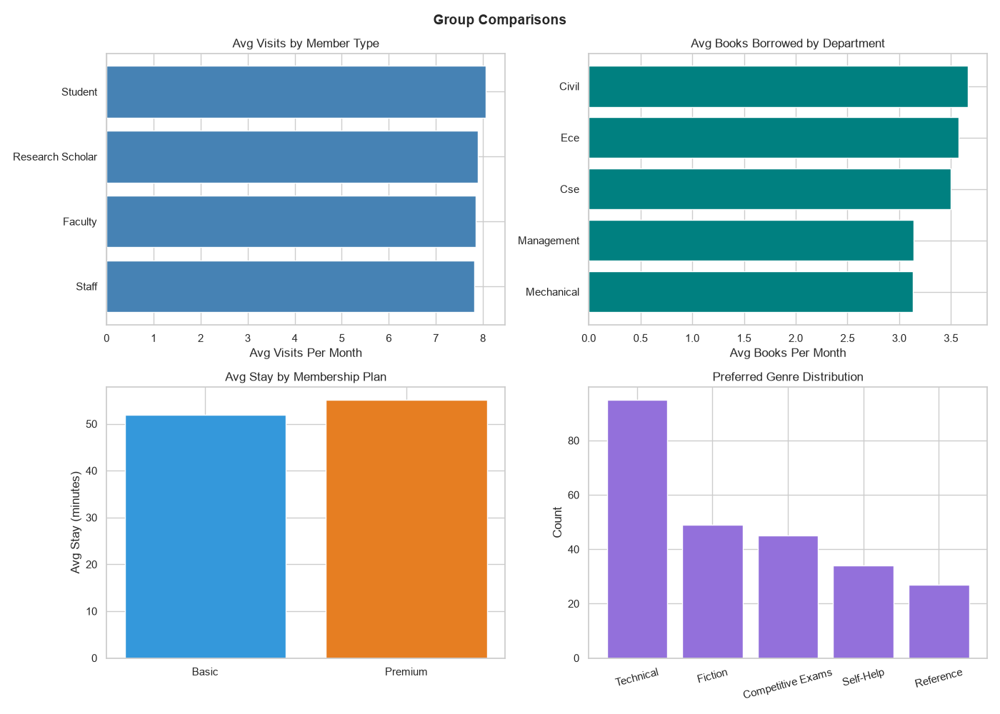

# Library Usage Analysis (Sample Data Analyst Project)

A beginner-friendly data analysis project for **B.Tech 1st Year – Data Analyst** learners.
It analyses what drives library usage patterns using Python, pandas, matplotlib and seaborn.

> The dataset is **provided as raw data** from the college library records.

## Business Problem
The college library wants to identify which factors influence how members use the library so that
the administration can improve services, increase engagement, and support academic goals.

## Questions Answered
1. What is the overall library usage pattern of members?
2. How do visits and book borrowing vary by member type, department, or membership plan?
3. Does distance from home affect visits or stay duration?
4. Which members are **low-engagement** (visits per month below 3)?

## Dataset
`data/raw/library_usage.xlsx` – 255 rows, 11 columns:

| Column | Description |
|---|---|
| Member_ID | Unique member identifier (L1001–L1250) |
| Member_Type | Student / Research Scholar / Staff / Faculty |
| Department | Academic department (CSE, ECE, Mechanical, etc.) |
| Preferred_Genre | Fiction / Technical / Self-Help / Competitive Exams / Reference |
| Membership_Plan | Basic / Premium |
| Age | Member age (has some impossible values intentionally) |
| Visits_Per_Month | Number of library visits per month |
| Avg_Stay_Minutes | Average time spent per visit (minutes) |
| Distance_From_Home_Km | Distance from home to library (km) |
| Visit_Date | Date of last recorded visit |
| Books_Borrowed_Per_Month | Number of books borrowed per month |

The raw file intentionally has **missing values, duplicate rows, inconsistent text, and impossible values** so you can practise cleaning.

## Project Structure
```
ABES_DA_Library_Usage_Project/
├── data/
│   ├── raw/library_usage.xlsx
│   └── processed/library_usage_clean.csv
├── notebooks/library_usage_analysis.ipynb
├── images/                   (charts saved by the notebook)
├── scripts/generate_data.py  (reference: shows how synthetic data is structured)
├── requirements.txt
├── .gitignore
└── README.md
```

## How to Run
```bash
git clone https://github.com/<your-username>/library-usage-analysis.git
cd library-usage-analysis
pip install -r requirements.txt
jupyter notebook notebooks/library_usage_analysis.ipynb
```

## Steps Followed
1. Load and inspect data
2. Clean data (duplicates, text standardisation, outliers, missing values)
3. Create new columns (Engagement_Level, Age_Group, Stay_Band)
4. Exploratory analysis with charts
5. Insights and recommendations

## Key Findings (from this dataset)
- Average visits per month ≈ 7–8; about 15–20% of members are "Low Engagement" (< 3 visits/month).
- Research Scholars and Faculty tend to stay longer per visit than Students.
- Premium plan members borrow more books on average.
- Members living closer to the library tend to visit more frequently.

## Charts





## Tools
Python 3 · pandas · NumPy · Jupyter Notebook · Git and GitHub

## Author
Sneha Pal – B.Tech 1st Year, ABES (2026B01010891)
